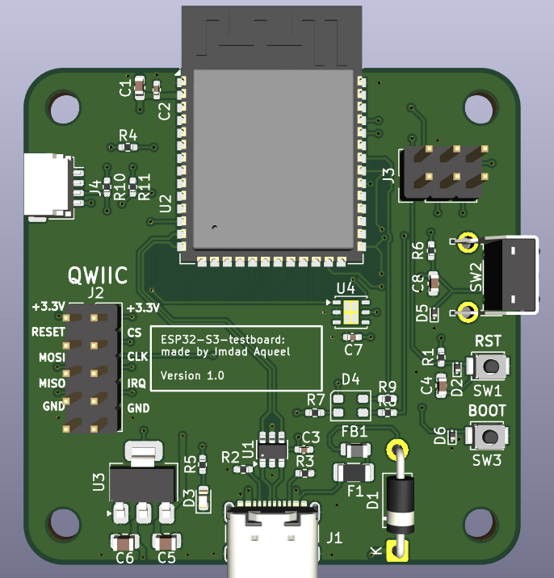
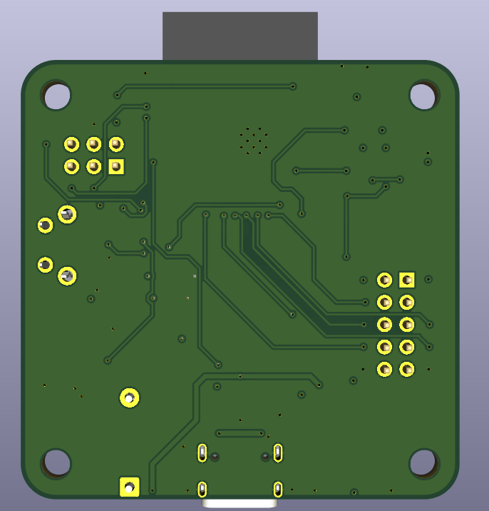

# ESP32-S3 Testboard

A custom ESP32-S3 test and development board designed in KiCad 9 for embedded systems and IoT prototyping.
Integrates the ESP32-S3-WROOM-1 module with power regulation, onboard sensing, programming interfaces,
and peripheral expansion on a compact 50 × 50 mm PCB.

---

## Board Preview

| Top | Bottom |
|-----|--------|
|  |  |

---

## Features

- **ESP32-S3-WROOM-1** — Wi-Fi + Bluetooth module, 8 MB flash
- **USB-C** — power and programming interface with ESD protection
- **Si7021-A20** — onboard temperature and humidity sensor
- **QWIIC connector** — I2C expansion for external sensors
- **BOOT / RESET / User buttons**
- **RGB LED** and 3.3 V power indicator LED
- **2×5 SPI expansion header**
- **2×3 programming header**
- **4× mounting holes** (3.2 mm)

---

## Power

| Rail  | Source                         |
|-------|--------------------------------|
| 5 V   | USB-C                          |
| 3.3 V | LM1117MP-3.3 voltage regulator |

---

## PCB Specifications

| Parameter        | Value      |
|------------------|------------|
| EDA Tool         | KiCad 9    |
| Copper Layers    | 4          |
| Board Dimensions | 50 × 50 mm |
| Mounting Holes   | 4 × 3.2 mm |

---

## Repository Structure

```
ESP32-S3-testboard/
├── ESP32-S3-testboard.kicad_pro
├── ESP32-S3-testboard.kicad_sch
├── ESP32-S3-testboard.kicad_pcb
├── fabrications/
├── docs/
│   ├── pcb_top.png
│   └── pcb_bottom.png
├── .gitignore
└── README.md
```

---

## Tools

- [KiCad 9](https://www.kicad.org/)

---

## Author

**Imdad Aqueel**  
B.Tech in Electronic and Communication Engineering, Bengaluru  
